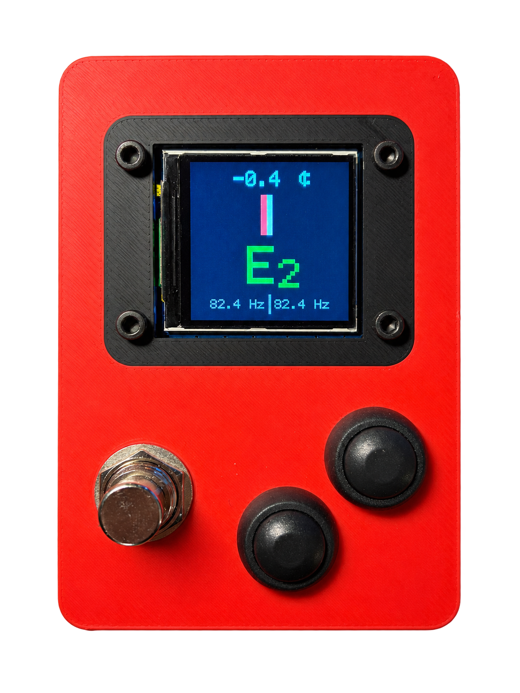
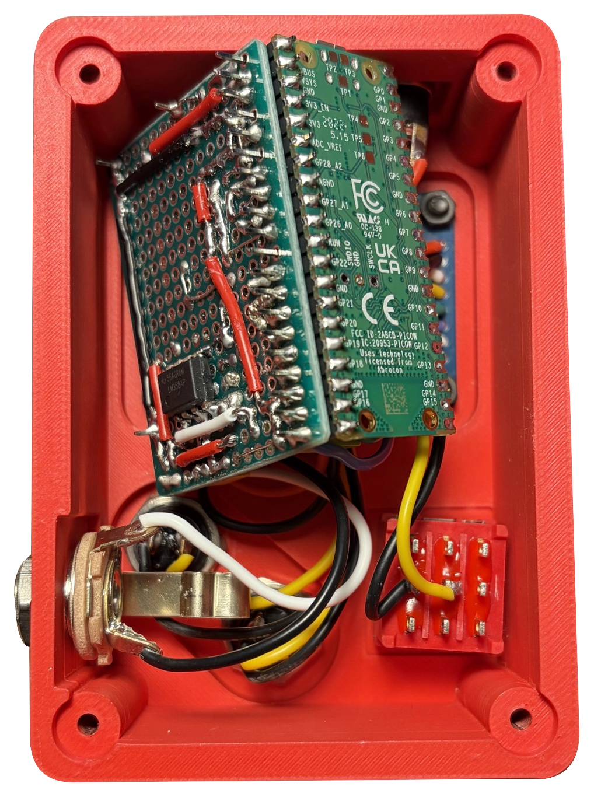
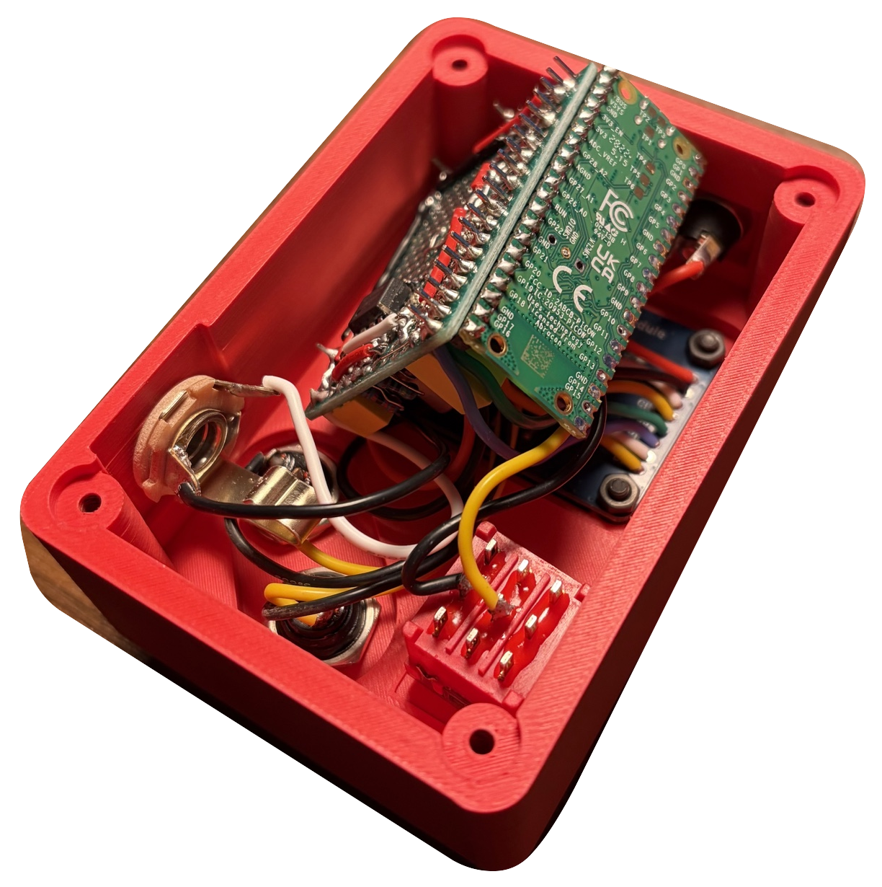

# Guitar Tuner Pedal

This guitar tuner pedal takes in a guitar signal, identifies the nearest musical note, and shows whether the string is sharp or flat. It has three power modes, selectable 50 Hz and 60 Hz hum filtering to reduce noise picked up by the guitar, and an adjustable A4 reference pitch.

  

I built the tuner to learn C++ and digital signal processing while making something I could use on my pedalboard. The BOSS FV-500H’s dedicated Tuner Out port let me build an input-only pedal. The tuner gets its own copy of the guitar signal while the rest of the rig uses the volume pedal’s main output.

## Controls and operation

The display shows the closest note and its octave, the measured and target frequencies, and the difference between them in cents. The tuning bar indicates which direction to adjust the string. A red border warns when the ADC samples approach the limits of its input range.

| Control | What it does |
| --- | --- |
| **Footswitch** | Tap to toggle between **On** and **Idle**. Hold for about one second to enter **Off**. Press again to resume tuning. |
| **Left and right buttons** | Move through the menu or change the selected setting. |
| **Both buttons together** | Open the settings menu, select a setting, or finish editing it. Select **RETURN** to apply and save your changes. |

**On** shows live tuning feedback. **Idle** pauses tuning and shows a static image. **Off** stops sampling and turns off the display while the pedal remains connected to power.

The hum filter can be set to **Off**, **50 Hz**, or **60 Hz**. The A4 reference defaults to **440 Hz** and can be adjusted from **400 to 480 Hz** in 1 Hz steps. The pedal saves both settings across power cycles.

*Demo placeholder — tune a string from flat or sharp to center.*

## How it works

The analog circuit biases, amplifies, and low-pass filters the guitar signal before the Raspberry Pi Pico W samples it. DMA transfers the samples into alternating buffers, giving the C++ firmware a complete frame to process while the next one fills. When enabled, the hum filter attenuates mains hum and its harmonics. If the signal is strong enough, YIN estimates its fundamental frequency. The firmware uses the selected A4 reference to find the nearest note, calculate the error in cents, and draw the feedback on a 1.54-inch SPI LCD.

## How I built it

### Conditioning the guitar signal

I started by simulating the analog circuit in LTspice, then built and revised it on a breadboard. The circuit amplifies the pickup signal so it makes better use of the Pico’s ADC range. A second-order Sallen–Key low-pass filter attenuates high-frequency content before sampling. Schottky clamp diodes near the ADC input limit voltages beyond the 0 V and 3.3 V rails when the pedal receives an unusually strong signal.

### Moving from waveform features to YIN

My first estimator tried to identify repeating cycles by matching rising midpoint crossings and comparing pulse heights and widths. I added hysteresis to cut down on noise-triggered crossings, tracked signal statistics to detect quiet input, and tuned the tolerances for accepting and rejecting candidate periods. It worked well on clean sine waves, but guitar signals could cross the midpoint several times in a single cycle. Comparing more features made the estimator more complicated, and it still struggled to track a decaying guitar note reliably.

The YIN algorihtm gave me more reliable results on real guitar signals. For each frame, it compares the waveform with copies shifted by different numbers of samples, called lags. It calculates the sum of squared differences for each lag and normalizes those values using their cumulative mean. Then it finds the first valley that drops below a threshold and follows it to its minimum. A parabola fitted through that point and its two neighbors refines the period to a fraction of a sample. Dividing the sample rate by that refined period gives the estimated frequency.

### Tracking down pickup hum

I first used two digital notch filters at 60 Hz and 120 Hz. When I looked at the pickup signal in the Analog Discovery 2 spectrum analyzer, I could see higher harmonics that those two filters missed. I switched to a notch comb filter that attenuates the mains frequency and its harmonics across the sampled frequency range. I also added a 50 Hz option and a way to turn filtering off. Working through FIR and IIR designs taught me how to use the Z-transform’s time-shifting property to connect difference equations to transfer functions, plot their poles and zeros in the complex plane, and predict their frequency response.

### Putting it together as a pedal

While developing the filters and YIN estimator, I switched from per-sample ADC interrupts to DMA. That moved acquisition into hardware and let the firmware work with continuous sample frames. I then built the ST7789 display driver, live tuning screen, two-button settings menu, and footswitch-controlled power modes. I transferred the analog circuit to perfboard and designed a 3D-printed enclosure to mount the board, display, and controls.

| Top view | Angled view |
| :---: | :---: |
|  |  |

## Project files

| Path | Contents |
| --- | --- |
| [`picow_tuner_firmware/`](picow_tuner_firmware/) | Pico W C++ source, Pico SDK setup, and CMake build files |
| [`Design/Tuner_Single_Pedal_BOM.xlsx`](Design/Tuner_Single_Pedal_BOM.xlsx) | Single-pedal parts list, sourcing, and cost summary |
| [`Design/LTspice/`](Design/LTspice/) | [Editable LTspice schematic](Design/LTspice/Tuner_LTspice_Circuit.asc) and [schematic PDF](Design/LTspice/Tuner_LTspice_Circuit.pdf) |
| [`Design/DIY_Layout/`](Design/DIY_Layout/) | [Editable DIY Layout Creator file](Design/DIY_Layout/Tuner_PerfBoard_Layout.diy) and [perfboard layout PDF](Design/DIY_Layout/Tuner_PerfBoard_Layout.pdf) |
| [`Design/CAD/`](Design/CAD/) | [Fusion assembly](Design/CAD/Tuner_Assembly.f3d), [enclosure STEP model](Design/CAD/Tuner_Enclosure.step), and [dimension drawing](Design/CAD/Tuner_Enclosure_Dimensions.pdf) |
| [`Design/3D_Printing/`](Design/3D_Printing/) | Enclosure print files in [3MF](Design/3D_Printing/Tuner_Enclosure.3mf) and [STL](Design/3D_Printing/Tuner_Enclosure.stl) formats |

## Credits and references

| Topic | References |
| --- | --- |
| Pico W documentation | [Pico W datasheet](https://pip-assets.raspberrypi.com/categories/686-raspberry-pi-pico-w/documents/RP-008312-DS-2-pico-w-datasheet.pdf) [Pico W pinout](https://pip-assets.raspberrypi.com/categories/686-raspberry-pi-pico-w/documents/RP-008315-DS-1-PicoW-A4-Pinout.pdf) [Raspberry Pi Pico SDK API reference](https://www.raspberrypi.com/documentation/pico-sdk/index_doxygen.html#raspberry-pi-pico-sdk) |
| Pico W ADC code | [Raspberry Pi forum discussion](https://forums.raspberrypi.com/viewtopic.php?t=348495) [slimhazard's Pico W HTTP example, `tasks.c`](https://gitlab.com/slimhazard/picow-http-example/-/blob/master/src/tasks.c?ref_type=heads) |
| Tuner circuit schematics | [Arduino Guitar Tuner](https://www.instructables.com/Arduino-Guitar-Tuner/) [Elektor's DIY Guitar Tuner](https://www.elektormagazine.com/news/circuit-diy-guitar-tuner) [Cornell ECE 476 Digital Guitar Tuner](https://people.ece.cornell.edu/land/courses/ece4760/FinalProjects/s2004/ddb25/complete2.htm) [BOSS TU-3 service manual](https://stompboxelectronics.com/wp-content/uploads/2024/07/BOSS-TU-3-Service-Manual.pdf) |
| Frequency detection | [Piano key frequencies](https://en.wikipedia.org/wiki/Piano_key_frequencies) [Arduino Frequency Detection](https://www.instructables.com/Arduino-Frequency-Detection/) [Pitch detection algorithm overview](https://en.wikipedia.org/wiki/Pitch_detection_algorithm) [Arduino Pitch Detection Using AMDF](https://www.instructables.com/Arduino-Pitch-Detection-Algorithm-AMDF/) [Cycfi Research, Fast and Efficient Pitch Detection](https://www.cycfi.com/2017/10/fast-and-efficient-pitch-detection/) |
| YIN | [Tonalux, Why Pitch Detection Is Hard, and How YIN Solved It](https://tonalux.org/blog/yin-pitch-detection-algorithm-explained) [Sarah's Blog, A Comprehensive Look into the YIN Algorithm](https://hyuncat.com/blog/yin/) |
| Digital filtering | [LibreTexts, Difference Equations](https://eng.libretexts.org/Bookshelves/Electrical_Engineering/Signal_Processing_and_Modeling/Signals_and_Systems_%28Baraniuk_et_al.%29/12%3A_Z-Transform_and_Discrete_Time_System_Design/12.08%3A_Difference_Equations) [W3C Audio EQ Cookbook, filter formulas](https://www.w3.org/TR/audio-eq-cookbook/#formulae) [Comb filter overview](https://en.wikipedia.org/wiki/Comb_filter) |
| LCD | [Waveshare 1.54-inch LCD module documentation](https://www.waveshare.com/wiki/1.54inch_LCD_Module) [ST7789 controller datasheet](https://www.waveshare.com/w/upload/a/ae/ST7789_Datasheet.pdf) [Waveshare LCD driver example, `LCD_1in54.c`](https://github.com/waveshare/Pico_code/blob/main/c/lib/LCD/LCD_1in54.c) [Waveshare hardware configuration example, `DEV_Config.c`](https://github.com/waveshare/Pico_code/blob/main/c/lib/Config/DEV_Config.c) [RGB565 color picker](https://rgbcolorpicker.com/565) |
